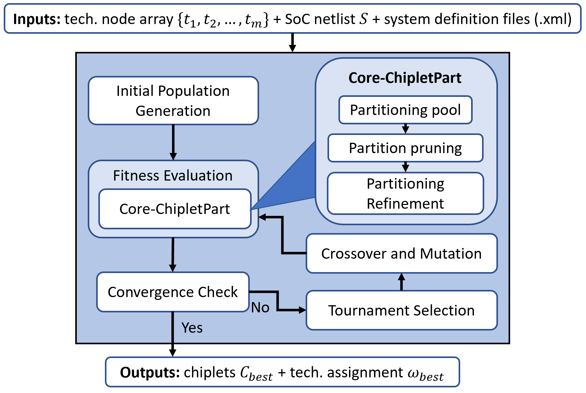

# ChipletPart

**ChipletPart** is an efficient framework designed for partitioning driven by chiplets technology. It aids in organizing and optimizing the design and layout of chiplets within a semiconductor module.
An example of an SoC netlist is the [Mempool testcase](https://github.com/bodhi91/ChipletPart/blob/main/MempoolGroupFromMempoolPaper.png). 

### Overall Flow ###
The overall flow is shown below: .

### Key features ###
- **Cost-driven partitioning.** Spectral/METIS initial partitions for every chiplet count are refined by
  FM and KL moves scored with the full chiplet cost model (dies per wafer, yield, assembly, test, IO,
  NRE), and the cheapest design is reported.
- **Floorplan-feasibility-aware refinement** ([details](#floorplan-feasibility)). Every move is checked
  with a short, warm-started sequence-pair floorplan probe, so the reported partition is placeable with
  every inter-chiplet bundle within its IO reach. Infeasible starts are repaired; cheaper but unplaceable
  partitions are never reported (`--no-floorplan-aware` turns this off).
- **Cost-aware floorplanner.** The final floorplan's feasible arrangements are ranked by the cost model and
  the chiplet shapes are refined against it under the reach constraint; candidates are ranked and
  `Best cost` is reported by this post-floorplan cost.
- **Iterated local search.** Kick-and-repair moves off the plateau that gated FM reaches, run in
  parallel and accepted only when feasible and cheaper after floorplanning (`--ils-kicks`, `--ils-parents`).
- **Lower bounds and MIP seeds** ([details](#lower-bounds-and-mip-seeds)). `tools/mip_seed.py` solves a
  mixed-integer relaxation of the cost model with HiGHS: it reports how far a result can be from the
  optimum (0.6 – 1.1% on EPYC, GA100 and WS₁) and writes seed partitions that `--init-partition` adds
  to the search (cheaper WS₃ designs).
- **Reproducible results.** The final arrangement is saved next to the partition (`*.cpart.N.fp`);
  evaluation mode starts from it and reproduces the partitioner's cost and feasibility. Runs are
  deterministic for a given `--seed` regardless of the thread count.
- **Heterogeneous technology assignment** by genetic algorithms or exhaustive enumeration
  ([details](#heterogeneous-mode)), and an **evaluation mode** for existing partitions.

### Repository layout ###
1. `src/` – the partitioner (`ChipletPart`, FM/KL refiners, sequence-pair floorplanner, GAs, CLI in `Main.cpp`).
2. `cost_model/` – the C++ chiplet cost model (`evaluator_cpp`, `design::*`) and its unit tests.
3. `test_data/<case>/` – one directory per benchmark, each containing `io_definitions.xml`, `layer_definitions.xml`,
   `wafer_process_definitions.xml`, `assembly_process_definitions.xml`, `test_definitions.xml`,
   `block_level_netlist.xml` and `block_definitions.txt` (columns: `name area_mm2 power_W tech is_memory`).
4. `test_case_gen/generateSystemDefinition.py` – the wafer-scale (WS) netlist generator.
5. `run_*.sh` – run scripts (see [Usage](#usage-directions)). Results go to `results/`; `test_data/` is never written to.
6. `tools/` – `mip_seed.py` (MIP lower bounds and seed partitions) and `cost_probe.cpp`, the cost-model
   sampler it uses (see [Lower bounds and MIP seeds](#lower-bounds-and-mip-seeds)).

Dependencies: CMake ≥ 3.14, a C++17 compiler, OpenMP, Boost (headers), Eigen 3, METIS 5 (+ GKlib) and pugixml (bundled in `src/`).

### List of testcases ###

| Benchmark | Directory | # Tiles | # IP Blocks | Area (mm²) | Area Scaling | Power Scaling |
|-----------|-----------|---------|-------------|------------|--------------|---------------|
| WS₁ | `48_1_14_4_1600_1600` | 1 | 48  | 1582 (45nm)   | 1600 | 1600 |
| WS₂ | `48_2_14_4_1600_1600` | 2 | 96  | 3165 (45nm)   | 1600 | 1600 |
| WS₃ | `48_4_14_4_1600_1600` | 4 | 192 | 6330 (45nm)   | 1600 | 1600 |
| WS₄ | `48_8_14_4_1600_1600` | 8 | 384 | 12,660 (45nm) | 1600 | 1600 |
| MP  | `mempool_group`       | 16 | 40 | 494 (45nm)    | 100  | 100  |
| EPYC | `epyc7282`           | N/A | 32 | 148 (7nm)     | 1    | 1    |
| GA100 | `ga100`             | N/A | 180 | 548 (7nm)    | 1    | 1    |

> **Note:** MP and WS benchmarks use tile terminology; the other benchmarks do not.

To generate a WS testcase with `Z` wafer scale, `A` tiles, `B` cores, `C` shared memories, `D` area scale and `E` power scale:
```bash
cd test_case_gen
python3 generateSystemDefinition.py ws-48 1 14 4 1600 1600   # WS_1
python3 generateSystemDefinition.py ws-48 2 14 4 1600 1600   # WS_2
python3 generateSystemDefinition.py ws-48 4 14 4 1600 1600   # WS_3
python3 generateSystemDefinition.py ws-48 8 14 4 1600 1600   # WS_4
```

## Building ChipletPart

### Prerequisites

CMake ≥ 3.14 and a C++17 compiler (GCC ≥ 9 or Apple clang).

```bash
# macOS
brew install cmake libomp boost eigen metis
# Debian / Ubuntu
sudo apt install cmake g++ libomp-dev libboost-dev libeigen3-dev libmetis-dev
```

METIS is found automatically from Homebrew / the system (`-DMETIS_PREFIX=<prefix>` to override).
To build METIS from source instead, `git submodule update --init` and CMake will use `METIS/` and `GKlib/`.
`-DDISABLE_METIS=ON` builds without METIS (random initial partitions).

### Build Instructions

```bash
mkdir build && cd build
cmake ..                      # Release by default
make -j8
cd ..
./run_chiplet_test.sh ga100 --seed 1
```

Useful CMake options: `-DENABLE_NATIVE_ARCH=ON` (`-march=native`, binary is then not portable),
`-DBUILD_COST_MODEL_TESTS=ON` (then `ctest` in `build/` runs the cost-model unit tests),
`-DBUILD_COST_MODEL_EXAMPLES=ON`, `-DENABLE_OPENMP=OFF`.

ChipletPart operates in four modes: (1) homogeneous, (2) heterogeneous (GA), (3) technology enumeration and (4) evaluation.

## Homogeneous mode ##
A single technology node for every chiplet:
```bash
./run_chiplet_test.sh ga100 --seed 1            # default tech 7nm
./run_chiplet_test.sh ga100 --tech 14nm
```
Results are written to `results/<case>/standard/` (override with `--output-dir`).

### Sample output (epyc7282, 7nm, seed 42) ###
```
+------------+----------------------+------------+------------------+------------------+------------+
| Rank       | Partition Index      | Parts      | Cost             | Refined cost     | Feasible   |
+------------+----------------------+------------+------------------+------------------+------------+
| 1          | 17                   | 8          | 71.228477        | 71.296188        | Yes        |
| 2          | 15                   | 7          | 72.562843        | 72.612068        | Yes        |
| 3          | 16                   | 8          | 73.097603        | 72.839340        | Yes        |
[INFO] Floorplanner results: Yes
[SUCCESS] Best cost: 71.228477
[SUCCESS] Number of partitions: 8
[SUCCESS] Floorplan feasibility: 1
[SUCCESS] Pre-floorplan cost: 71.296188
[SUCCESS] Post-floorplan cost: 71.228477
[SUCCESS] Best partition saved to results/epyc7282/standard/block_level_netlist.xml.cpart.8
[SUCCESS] Floorplan seed saved to results/epyc7282/standard/block_level_netlist.xml.cpart.8.fp
```
`Cost` / `Best cost` is the cost of the design with its final floorplan applied (the number evaluation
mode reports for the saved partition); `Refined cost` / `Pre-floorplan cost` is the cost the
refinement optimised, which assumes square chiplets. Candidates are ranked by the former, so a
candidate with a slightly higher refined cost can win (as above: 16 refines to 72.84 but floorplans
to 73.10, 17 refines to 71.30 and floorplans to 71.23).

### Floorplan feasibility ###
A partition is *feasible* when the sequence-pair floorplanner can place the chiplets (at least
`<separation>` apart, plus the IO shoreline each inter-chiplet bundle needs) so that every bundle is
within its IO `reach`. `<separation>` is the minimum gap between two chiplets, the same quantity as
the cost model's `die_separation` in `assembly_process_definitions.xml` (0.1 mm for the shipped
benchmarks, and the scripts' default); each chiplet carries half of it as a
halo. `Floorplanner results` / `Floorplan feasibility` report this for the final
partition and are authoritative; the `Feasible` column is the result of the shorter per-candidate run.

By default the refinement is **floorplan-aware**: every FM move and KL swap is followed by a short,
warm-started floorplan probe of the resulting partition, each pass is rolled back to the prefix with
the lowest reach violation (then the highest gain), and candidates are ranked feasible-first. The
cost of the winning partition is therefore the best cost *among feasible designs*; a cheaper but
unplaceable partition (e.g. EPYC at 70.83 with 8 chiplets) is not reported.
`--no-floorplan-aware` restores pure cost-driven refinement (faster, may be infeasible);
`--fp-check-budget S,P` sets the probe budget (default `40,25`).

The floorplanner is **cost-aware**. Of a floorplan only the chiplet shapes enter the cost model
(dies per wafer, reticle fit, IO shoreline), and the annealer's own objective (area, package, reach
penalty) is only a proxy for it: two feasible floorplans of the same partition can differ by a few
percent in cost. So every feasible walker's chiplet shapes are refined against the cost model under
the reach constraint, and the cheapest feasible floorplan is returned. Each refined candidate gets a
short such floorplan (its result is the candidate's cost), the three cheapest feasible candidates get
the full final floorplan (`--fp-steps x --fp-perturbs` perturbations per walker on `--fp-workers`
walkers, default 1000 x 1000 on 8), and the cheapest of those is reported. `--no-fp-cost-aware`
selects by the annealer's objective instead. The final arrangement is saved next to the partition
(`*.cpart.N.fp`) and evaluation mode starts from it, so the saved partition reproduces its cost and
feasibility.

The refinement ends with an **iterated local search**. From a refined feasible partition nearly every
single-vertex move is vetoed by the gate (about 90% on EPYC and GA100 at 8 chiplets), so FM sits on
a plateau that it cannot leave one vertex at a time. A kick moves 2-4 boundary vertices of the
cheapest feasible candidate to a neighbouring chiplet (within the balance bounds), one short gated
FM pass repairs it, it is floorplanned, and it replaces its parent when it is feasible and cheaper.
Kicks run in rounds of 8 (in parallel), up to `--ils-kicks` per parent (default 256, `0` disables),
stopping after two rounds without improvement (on the reference designs the search ends after
16-180 kicks); `--ils-parents` kicks more than one candidate. The
result is deterministic for a given seed. `--fp-excursion <frac>` additionally lets a feasible pass
walk through partitions that violate the reach by up to `frac` x the total weighted reach before
the usual rollback; it changed nothing on the reference designs and is off by default.

Results with the default settings (7nm, reach 0.5, separation 0.1; `Best cost` / chiplets over
seeds 1, 2, 3 and 42, all feasible). `--ils-kicks 0` is the same search without the iterated local
search (seed 42); "Previous floorplanner" is the feasibility-aware search with the earlier
floorplanner (walker chosen by the annealer's objective, no shape refinement, candidates ranked by
refined cost; measured with the earlier 0.5 mm gap, see below); "Cost-only" is
`--no-floorplan-aware`, whose EPYC and GA100 designs are **not** placeable:

| Case | Default | `--ils-kicks 0` | Previous floorplanner (seed 1) | Cost-only (seed 42) |
|------|---------|-----------------|--------------------------------|---------------------|
| EPYC (`epyc7282`) | 71.23 – 71.25 / 8 | 72.25 / 8 | 72.27 / 8 | 71.80 / 8 (infeasible) |
| GA100 (`ga100`) | 70.24 / 8 | 70.24 / 8 | 71.17 / 8 | 71.48 / 8 (infeasible) |
| WS₁ (`48_1_14_4_1600_1600`) | 48.97 – 49.41 / 4 – 6 | 49.76 / 7 | 50.12 / 4 | 49.79 / 7 |
| WS₃ (`48_4_14_4_1600_1600`) | 242.60 – 243.70 / 8 | 259.17 / 8 | 262.40 / 8 | 259.82 / 8 |
| MP (`mempool_group`) | 5.81 / 1 | 5.81 / 1 | 5.82 / 1 | 5.81 / 1 |

Runtime on a laptop (8 threads): EPYC and GA100 about 11 s, WS₃ 40 – 45 s, WS₁ 10 s, MP 4 s
(without the local search: 9 s, 17 s, 5 s, 3 s).

Until commit `c133f49` the floorplanner used the whole `<separation>` as the halo of *each* chiplet,
so two chiplets were kept 2 × separation apart (0.5 mm with the then-default 0.25) while the cost
model assumed 0.1 mm. Both the halo (now separation / 2) and the default (now 0.1, the assembly
process's `die_separation`) have been corrected; with the same gap as before (`--separation 0.5`) the
results are unchanged, and the old designs remain feasible at the new default (e.g. the EPYC design
above evaluates to 71.20).

### Lower bounds and MIP seeds ###
`tools/mip_seed.py` answers "how much is left on the table" and produces starting points the
heuristic does not find on its own. It samples the cost model with the `cost_probe` helper
(CMake target `cost_probe`, built in `build/bin/`), builds a mixed-integer relaxation with
[HiGHS](https://highs.dev) and solves it per chiplet count:

- binaries `x[v,k]` assign block `v` to chiplet `k`; cut indicators give each chiplet's IO area and the
  interposer signal count `S`;
- the per-chiplet cost `f(W)` (incl. yield, minimised over aspect ratio) and the interposer cost `g(U)`
  are replaced by supporting lines of their lower convex hulls, the yield factor `exp(λS)/Y₀` by a
  tangent at `--s0` plus a McCormick bound, so the MIP optimum (or its dual bound at the time limit) is
  a valid lower bound on the cost of *any* partition into `K` chiplets, floorplan feasibility ignored
  (up to the 0.25 mm² sampling grid of `f`);
- the MIP's own partition is written as `<out>/<case>.K<k>.part`, and `--init-partition <file>` adds it
  to the partitioner's initial candidates (repeatable; `--topology-from <part>` restricts the MIP to the
  chiplet adjacencies of an existing feasible partition).

```bash
pip install numpy highspy
cmake --build build --target cost_probe
tools/mip_seed.py test_data/48_4_14_4_1600_1600 --k 8 --time 600 --out seeds
./run_chiplet_test.sh 48_4_14_4_1600_1600 --init-partition seeds/48_4_14_4_1600_1600.K8.part
```

| Case | Lower bound (K) | Best feasible result | Gap |
|------|-----------------|----------------------|-----|
| EPYC | 70.48 (8); 71.23 (7), higher for K ≤ 6 | 71.23 / 8 | ≤ 1.1% |
| GA100 | 69.77 (8, MIP solved to optimality) | 70.24 / 8 | 0.7% |
| WS₁ | 48.68 (5); 48.78 (6), 49.09 (4), 49.06 (7), 49.50 (8) | 48.97 / 4 – 6 | 0.6% |
| WS₃ | 224.75 (8), 226.7 (7) after 2 × 600 s, MIP not converged | 242.39 / 8 (seeded) | ≤ 7.9% (open) |
| MP | 5.81 (1); 6.09 (2), ≥ 6.50 (K ≥ 3) | 5.81 / 1 | optimal |

The relaxation ignores placeability, and its unconstrained optima are not placeable on EPYC and GA100
(the chiplet adjacency graph is non-planar), so on those designs the seeds change nothing (EPYC
71.23, GA100 70.23 vs 70.24); with the MIP restricted to the topology of the heuristic's best EPYC
design the two agree to 0.03%. On WS₃ the seed is feasible and the partitioner finishes at
**242.39 – 242.58** over seeds 1, 2 and 42 (default 242.60 – 243.70) in the usual 30 – 45 s; solving
the MIP takes minutes offline (`--time` per solve, two solves per `K`) and is done once per design. The WS₃ bound is loose because HiGHS does not close the MIP in that time; the other
designs are solved to optimality or within 0.2%.

`--fp-second-tier <n>` re-probes an improving move that the cheap feasibility probe vetoed with an
`n`× larger probe before rejecting it (from feasible states only, confirmed by a cheap probe warm-started
from the large one). About 5% of the vetoes are false, but accepting those moves does not help:
with `n = 4` GA100 is unchanged, WS₃ moves within noise (243.42 – 243.76) and EPYC ends at 7
chiplets (71.69 – 71.73) because the accepted moves lead the 8-chiplet candidates into states the
repair cannot place, so the option is off by default.

## Heterogeneous mode ##
Multiple technology nodes; partitioning and technology assignment are co-optimised by a genetic algorithm:
```bash
./run_chiplet_test.sh ga100 --genetic --tech-nodes 7nm,10nm,14nm --seed 1
./run_chiplet_test.sh ga100 --canonical-ga --tech-nodes 7nm,14nm --generations 30 --population 20
```
Both print a `Genetic Algorithm Results` table (`Best Cost`, `Number of Partitions`, per-partition technology)
and write `*.parts.N` / `*.techs.N` files to `results/<case>/<mode>/`.

## Technology enumeration ##
For small numbers of technologies and chiplets the search space is tiny (e.g. 5 unique canonical assignments for
2 technologies × ≤ 2 chiplets), so exhaustive enumeration is cheaper and deterministic compared with the GAs:
```bash
./run_chiplet_test.sh epyc7282 --tech-enum --tech-nodes 7nm,14nm --max-partitions 2
```
```
| Total Assignments Considered   | 6      |
| Unique Canonical Assignments   | 5      |
| Best Number of Partitions      | 2      |
| Best Technology Assignment     | [7nm, 14nm] |
| Best Cost                      | 85.264297   |
[SUCCESS] Best partition saved to results/epyc7282/tech_enum/block_level_netlist.xml.best_partition.txt
```

## Evaluation mode ##
Evaluate an existing partition (one chiplet id per line, in block order): it is floorplanned first and then costed.
```bash
./run_evaluator.sh ga100 --partition results/ga100/standard/block_level_netlist.xml.cpart.8 --tech 7nm
# equivalently
./run_chiplet_test.sh ga100 --evaluate-partition results/ga100/standard/block_level_netlist.xml.cpart.8
```
```
[INFO] Floorplan seed loaded from results/ga100/standard/block_level_netlist.xml.cpart.8.fp
[INFO] Cost of partition is 70.238197
[INFO] Number of partitions is 8
[INFO] Floorplan feasibility is 1
```
If a `<partition_file>.fp` seed (written by the partitioner) sits next to the partition file, the
floorplan starts from it and the evaluation reproduces the partitioner's `Best cost` and
feasibility. Without it the floorplan starts cold, and for tight designs (EPYC at 8 chiplets) a cold
run may end slightly costlier or even infeasible.

## Usage Directions ##
  ```
Usage: ./run_chiplet_test.sh <test_case_name> [options]

Modes (pick at most one; default is standard single-technology partitioning):
  --genetic                     Genetic tech partitioning (GeneticTechPartitioner)
  --canonical-ga                Canonical genetic algorithm for technology assignment
  --tech-enum                   Enumerate all canonical technology assignments
  --evaluate-partition <file>   Evaluate an existing partition file

Options:
  --reach <value>        Default IO reach for net types missing from the IO file (default: 0.50)
  --separation <value>   Minimum gap between chiplets used by the floorplanner (default: 0.1,
                         the cost model's die_separation)
  --tech <node>          Tech node for standard partitioning / evaluation (default: 7nm)
  --tech-nodes <list>    Comma-separated tech nodes for --genetic/--canonical-ga/--tech-enum
                         (default: 7nm,10nm,14nm; known nodes: 45nm 16nm 14nm 10nm 7nm)
  --seed <value>         Random seed (default: 42)
  --generations <num>    GA generations (default: 50)
  --population <num>     GA population size (default: 50)
  --max-partitions <n>   Max chiplets (default: 4 for --tech-enum, 8 for the GAs)
  --detailed-output      Extra per-assignment output for --tech-enum
  --output-dir <dir>     Where to write results (default: results/<case>/<mode>)
  --no-floorplan-aware   Disable feasibility-gated refinement (standard mode)
  --fp-check-budget S,P  Per-move floorplan probe budget (default: 40,25)
  --fp-steps <n>         Final floorplan SA steps per walker (default: 1000)
  --fp-perturbs <n>      Final floorplan perturbations per step (default: 1000)
  --fp-workers <n>       Final floorplan parallel walkers (default: 8)
  --no-fp-cost-aware     Floorplanner picks by the SA objective, no cost-model shape refinement
  --ils-kicks <n>        Iterated local search: up to <n> kick-and-repair attempts per parent
                         after refinement (default: 256; 0 = off)
  --ils-parents <n>      Cheapest feasible candidates to kick (default: 1)
  --fp-excursion <frac>  Feasibility gate: tolerate reach violations up to <frac> x reach scale
                         within a pass that starts feasible (default: 0 = strict)
  --fp-second-tier <n>   Re-probe an improving move vetoed by the cheap probe with an <n>x
                         probe before rejecting it (default: 0 = off)
  --init-partition <f>   Add the partition in <f> (one chiplet id per line) to the initial
                         candidates; repeatable (e.g. a seed from tools/mip_seed.py)
  --help                 Show this message

Examples:
  ./run_chiplet_test.sh 48_1_14_4_1600_1600 --tech 7nm
  ./run_chiplet_test.sh epyc7282 --genetic --tech-nodes 7nm,10nm,14nm --seed 123
  ./run_chiplet_test.sh epyc7282 --canonical-ga --tech-nodes 7nm,14nm --generations 30 --population 20
  ./run_chiplet_test.sh ga100 --tech-enum --tech-nodes 7nm,10nm,14nm --max-partitions 3
  ./run_chiplet_test.sh ga100 --evaluate-partition results/ga100/standard/block_level_netlist.xml.cpart.8
  ```

The binary itself (`build/bin/chipletPart --help`) takes the same options; per-net IO reach always
comes from the `reach` attribute in `io_definitions.xml`, and the `<reach>` positional is only the
fallback for net types that are not listed there. The cost model knows the technology nodes
45nm, 16nm, 14nm, 10nm and 7nm; any other node name is rejected.

   
